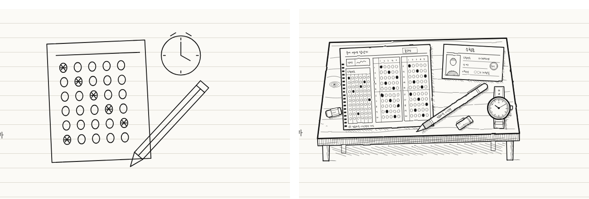

# 라인아트 토론 기록 (그림 중심 2라운드)

채점자 4명이 매 라운드 실제 화면 스크린샷을 보고 그림만 채점했어요. 기준: 섬세함, 펜 질감, 애니메이션, 고1 백과와의 어울림. 9.5 = 전문 일러스트레이터 수준.

| 라운드 | 🔴 RED | 🔵 BLUE | 🟡 YELLOW | 🟣 PURPLE | 평균 |
|---|---|---|---|---|---|
| 1 | 5.8 | 7.1 | 7.2 | 7.1 | 6.80 |
| 2 | 6.7 | 7.6 | 7.8 | 7.6 | 7.43 |

## 라운드 1

### ⚫ BLACK (저자) 바꾼 것

- 표지 그림을 새로 그렸어요 (/tmp/claude-0/-home-user/15874408-5af3-5bb7-95f2-a9c4f9309bb6/scratchpad/suneung.html, #art-hero, viewBox 0 70 480 292). 원근이 들어간 시험장 책상에 나뭇결, 옹이, 앞판 겹빗금, 책상 밑 그림자를 넣었어요. OMR 답안지에는 타이밍 마크, 성명 칸, 수험번호 6열×10행 마킹, 20문항×5지선다, 홀수형 표시를 그렸어요. 그 밖에 띠·홀더 링·클립·'컴퓨터용 사인펜' 글자가 있는 사인펜과 뚜껑, 사진 칸·도장이 있는 수험표, 눈금 60개·바늘·유리 반사가 있는 손목시계, 지우개도 넣었어요.
- '장면으로 보는 수능' 섹션을 새로 만들었어요 (#scenes, '우리 가족 수능 찾기'와 '학년도별 기록' 사이). 펜 그림 장면 4개를 넣었어요 (#art-1994, #art-2001, #art-2019, #art-2021). 1993년 8월 첫 수능 교실(칠판 글씨, 감독관, 원근이 있는 책상 3줄과 학생 뒷모습, 시계, 한여름 창문), 2001 물수능(물이 차서 종이배가 뜨고 넘쳐 흐르는 답안지, 물방울, 웅덩이), 2019 국어 31번(사과, 지구와 달 궤도, 힘 F 화살표, F=G·Mm/r², 31번 시험지), 2021 코로나 교실(2020년 12월 3일 달력, 마스크 쓴 학생, 투명 칸막이와 반사광, 옆자리 칸막이, 손소독제)이에요.
- 각 장면 캡션은 고1 눈높이의 존댓말로 썼어요. 캡션 링크는 기존 a.goto 처리기로 해당 카드(#y-1994-1, #y-1994-2, #y-2001, #y-2019, #y-2021)에 이어지고, 필터가 걸려 있으면 자동으로 '전체'로 돌아가요. 2001 캡션에는 아직 출처를 확인하지 못한 66명을 단정해서 적지 않았어요.
- 펜 질감을 넣었어요. 선 굵기를 네 단계(w3 2.4, w2 1.6, w1 .95, w0 .6)로 나눴고, .dbl 클래스가 붙은 윤곽은 JS가 살짝 어긋난 두 번째 가는 선을 겹쳐 그려요. 선 끝과 꺾이는 곳은 둥글게 했어요. 아주 약한 떨림 필터(#pen: feTurbulence baseFrequency .04, feDisplacementMap scale 1.4)도 걸었어요. 빗금은 JS hatch() 함수가 시드 고정 난수로 다각형 안을 채워요(오목한 모양도 돼요). 선 2031개가 모두 JS로 만들어져요.
- 그리는 순서를 연출했어요. 요소마다 data-l 층(1 윤곽, 2 디테일, 3 빗금)에 따라 지연 시간을 매기고, 선 길이에 비례해 그리는 시간을 정해요. 기본값은 다 그려진 그림이에요. 움직임 줄이기 설정이 꺼져 있고 IntersectionObserver가 있을 때만 .ink-play를 덧붙여 다시 그려요. 표지는 처음 열 때 바로, 장면은 화면 아래 10% 앞에서 한 번만 그려요. 대기 상태나 opacity:0은 없고, prefers-reduced-motion에서는 애니메이션을 끄도록 CSS 규칙을 넣었어요.
- z순서를 고쳤어요. 그림자 빗금이 종이색으로 채운 물체보다 위에 올라오던 문제(답안지·수험표·시계·펜·뚜껑·지우개·시험지·달력·손소독제), 1994 칠판 빗금이 글씨를 덮던 문제, 1994 책상 줄 사이 빗금이 겹치던 문제(책상마다 그룹을 따로 둠), 종이배 위로 물결선이 지나가던 문제를 바로잡았어요. 2019는 달을 지구 밖으로 옮기고 '?'와 F 라벨 위치를 고쳤어요.
- 색은 --ink와 --paper 토큰만 써요. 팀 칩 색은 그대로예요. 새 CSS와 JS는 svg.art 범위와 즉시 실행 함수 안에만 있어서, 기존 그래프·카드·inkify에는 영향이 없어요.
- 검증한 내용이에요. node new Function으로 스크립트 문법 검사를 통과했어요. r1 촬영 결과 폰 scrollWidth는 390이에요. 콘솔 오류는 0건이에요. 움직임 줄이기 설정에서는 .ink-play가 0개라 완성된 그림이 바로 보여요. 카드 37장, 가족 찾기(1982→2001학년도), 표준점수 시대 필터(13장), 링크를 누르면 필터가 '전체'로 돌아가는 동작 모두 정상이에요. 확인용 이미지는 /tmp/claude-0/-home-user/15874408-5af3-5bb7-95f2-a9c4f9309bb6/scratchpad/shots/r1-desktop-top.png, r1-anim.png, r1-phone-top.png, r1-scenes-d.png, r1-scenes-p.png, r1-scene-mid.png예요. 그림 원본 코드는 /tmp/claude-0/-home-user/15874408-5af3-5bb7-95f2-a9c4f9309bb6/scratchpad/art.js이고, merge.py가 suneung.r5.bak에 이 코드를 합쳐 suneung.html을 만들어요.

받아들이지 않은 의견:

- 화면에 들어오기 전 장면을 미리 숨겨 두는 대기 상태는 쓰지 않았어요. 기본값은 완성된 그림이고, 화면 바로 아래 10% 지점에 닿을 때 다시 그려서 '처음부터 최종 모습' 문제를 피했어요. 처음 로드 때 내용이 보여야 한다는 규칙과 opacity:0 대기 금지 때문이에요.
- 외부 스크립트나 라이브러리는 추가하지 않았어요.
- 만점자 수, 출처, DATA, 퀴즈, 가족 찾기, 그래프 코드는 고치지 않았어요.

### 🔴 RED — 5.8점

RED 1라운드: 빈약하던 그림에서 "아이콘을 모아 놓은 수준"까지는 왔어요. 하지만 섬세한 펜 일러스트라고 하기는 아직 멀어요. 사람은 원과 반원이고, 빗금은 기계처럼 똑같은 간격이에요. 화면 끝에서 잘리는 곳과 겹치는 곳도 남아 있어요.

> BLACK에게: 선 2031개로 양은 늘었지만, 화면에서 보이는 품질은 '기본 도형 + 같은 빗금'이에요. 2라운드에서 먼저 고칠 것은 다음과 같아요. (1) 사람에게 어깨, 팔, 손, 의자를 그려 주세요. 1993·2021은 사람이 주인공이에요. (2) 표지 책상 밑 그림자와 다리가 viewBox에서 잘리는 문제를 viewBox를 늘리거나 그림자를 줄여서 해결해 주세요. 2019 나뭇가지와 2021 양옆 칸막이가 카드 끝에서 잘리는 것도 정리해 주세요. (3) 겹침을 고쳐 주세요. 종이배가 마킹을 가리는 것, 달 궤도가 지구를 관통하는 것, 지구 빗금이 대륙과 겹치는 것, 중복된 '?', 떠 있는 F 라벨이에요. (4) 빗금에 간격·길이·각도 흔들림과 끝 흩어짐을 넣고, 앞판의 격자 빗금은 성기게 해서 회색 띠를 없애 주세요. 떨림 필터도 눈에 보일 만큼 올려 주세요. 윤곽은 확실히 굵게, 디테일은 가늘게 해서 굵기 대비를 키워 주세요. (5) 애니메이션에서 채운 마킹 점과 채우기 요소가 윤곽보다 먼저 튀어나오지 않도록, 3층 이후에 페이드나 스트로크로 등장하게 해 주세요. (6) 펜·시계·지우개 밑에 접지 그림자를 넣고, 책상에 실제 원근(먼 쪽이 좁아지는 사다리꼴)과 휘어진 나뭇결·옹이를 그려 주세요. 지금은 5.8점이에요.

- [표지·원근] '원근이 들어간 책상'이라고 했지만 실제로는 평평한 평행사변형이에요. 나뭇결은 같은 간격의 가로 직선 몇 개라서 결도 옹이도 보이지 않아요(zoom: shots/r1-red-hero-zoom.png). 앞판 겹빗금은 촘촘한 격자라 펜 선이 아니라 회색 띠처럼 보여요.
- [표지·잘림] 책상 밑 그림자 빗금과 다리가 viewBox 아래 끝(y≈335)에서 그대로 잘려요. 다리 끝이 보이지 않고, 그림자는 다리 밖까지 사선이 뻗다가 잘려서 '그리다 만' 느낌이에요. 폰(r1-red-phone-top.png)에서도 똑같이 잘려요.
- [표지·물체] 왼쪽 지우개는 줄무늬 사각형이라 무엇인지 알아보기 어려워요. 펜 옆 뚜껑도 그냥 둥근 직사각형이에요. 펜·시계·지우개 밑에 접지 그림자가 없어서 책상 위에 떠 있어요. 시계 줄은 책상 앞 모서리선 위로 그냥 겹쳐요.
- [표지·디테일 가독성] OMR 열 머리 숫자, '컴퓨터용 사인펜' 글자, 수험표 글자가 데스크톱 원본 크기에서도 읽히지 않을 만큼 작아요. 디테일을 넣었다는 주장이 화면에서는 노이즈 점으로만 보여요.
- [애니메이션] r1-red-anim.png를 보면, 표지 윤곽이 그려지는 도중인데 OMR 마킹(채운 점)과 동그라미가 이미 다 나와 있어요. 채우기 요소는 선을 따라 그려지지 않고 한 번에 튀어나와요. 그래서 '펜으로 그려 나가는' 순서가 깨지고, 윤곽보다 먹칠이 먼저 보여요.
- [1993 교실] 학생이 책상 앞 모서리 위에 올린 동그라미 하나예요. 어깨·팔·의자가 없어서 '책상 위의 공'처럼 보여요. 감독관도 교탁 위의 원 하나이고 몸이 없어요. 바닥 원근선은 교탁에서 퍼지는데 책상 3줄은 그 소실선에 맞춰져 있지 않아서 원근이 어긋나요.
- [1993 칠판] 빗금이 글씨 둘레를 피하긴 했지만, 글씨 바로 옆까지 빽빽해서 '제1회 1993년 8월'이 빗금에 묻혀요. 칠판 아래 중앙의 원(시계? 머리?)은 칠판 테두리와 겹쳐서 정체를 알 수 없어요.
- [2001 물수능] 종이배가 4~5번 문항 마킹 줄 위에 그대로 얹혀 있어서 동그라미를 가려요. 물이 '차 있는' 표현이 없어서 배가 종이 위에 붙은 스티커처럼 보여요. 물방울은 무작위로 흩어진 같은 모양 아이콘이고, 답안지 윗부분의 녹아내린 테두리는 물인지 불인지 헷갈려요.
- [2019 만유인력] 나뭇가지가 카드 왼쪽 끝에서 잘려 나와 허공에 떠 있어요(나무 둥치 없음). 달 궤도 타원이 지구 몸통을 뚫고 지나가요. 지구 위 그림자 빗금이 대륙 윤곽과 겹쳐서 얼룩처럼 보여요. F 라벨은 화살표에서 멀리 떨어져 떠 있어요. '?'는 시험지 아래에 크기가 다른 두 개가 중복돼 있어요. 오른쪽 아래 1/3은 비어 있어서 구도가 허전해요.
- [2021 코로나] 학생 몸은 빗금 친 반구이고 팔과 손이 없어요. 책상 위 종이와 펜이 손 없이 놓여 있어요. 양옆 칸막이는 카드 테두리에서 잘린 채 그냥 끝나요. 책상 앞판과 밑의 빗금이 다시 회색 띠가 돼서 장면에서 가장 시선을 끌어요(초점이 학생이 아니라 책상).
- [펜 질감 전반] 선 굵기를 4단계로 나눴다지만 화면에서는 윤곽과 디테일의 굵기 차이가 거의 느껴지지 않아요. feTurbulence scale 1.4는 너무 약해서 떨림이 보이지 않아요. 결국 '균일한 벡터 선'으로 보여요. .dbl 이중선도 축소하면 그냥 굵은 선 하나예요. 빗금 간격·각도·길이가 모두 같아서 손맛이 없어요(사람 손 빗금은 끝이 흩어지고 간격이 흔들려요).
- [고1 백과 어울림] 장면 4개의 주제 선택과 캡션은 적절해요. 다만 인물이 원 하나로 처리돼서 교재 삽화로 쓰기에는 유치하고, 사진처럼 섬세한 펜화와도 거리가 멀어요.

### 🔵 BLUE — 7.1점

The drawings are now a different class of work: from 3 SVGs and 10 paths up to one cover illustration and 4 scenes. The cover is the strongest part and must not be broken. The 4 scenes are rich in information, but the people and some of the shapes still look crude, which holds the score below 8.

> The cover drawing in this round is good work. It is good enough to get a 'wow, it's the real Suneung' from a high school first-year. Above all, keep the OMR, ticket, and watch detail, the desk shadow hatching, the four line weights, the outline-detail-hatching order, the default-finished-drawing structure, and the ink and paper tokens. Next round, put your effort into making the people in the scenes look like people, varying the hatching by material, and making the 2019 Earth and the 2001 water read clearly. That is not a reason to touch the cover. 7.1/10.

- Keep: the cover OMR answer sheet (#art-hero). The timing marks, the 6x10 exam-number grid, 20 questions x 5 choices with marked bubbles, and the odd-numbered-form label all read even at the small size in r1-blue-desktop-top.png. Together with the exam ticket (photo box, stamp), the watch (tick marks, hands, glass reflection), the 'computer sign pen' text on the pen, and the eraser, it gives the clearest sense of the actual Suneung that a high school first-year can recognize at a glance. It is the best drawing on the page.
- Keep: the dense cross-hatching under the desk's front edge and the diagonal shadow under the desk. They give the cover weight and depth. The difference in line weight (thick outlines vs thin detail) shows on screen and works as pen texture. Do not flatten the four weights (w3 to w0).
- Keep: the drawing order. In r1-blue-anim.png the outlines go down first, then the details (marks, text) fill in, and the shadow hatching is still missing. That is the order a pen would follow, so it looks natural. The structure that defaults to the finished drawing and adds .ink-play only when it can play is also correct. Do not bring back a hidden waiting state or opacity:0.
- Keep: the phone layout. In r1-blue-phone-top.png the cover drops below the text and fills the full width without cropping, and scrollWidth is 390. Do not change the viewBox or the responsive layout.
- Keep: the drawings use only the --ink and --paper tokens, so they sit well with the existing notebook-lined paper look. Do not add color.
- Keep: in the 4 scenes, the drawing and the caption say the same thing. The calendar reads '2020, 12월 3', the chalkboard reads '제1회 1993년 8월', the paper is 31번, and the caption links lead to the matching cards. This is accurate information and suits the encyclopedia. Do not lose this match.
- Weakness (honest deduction): the people in the scenes are crude. In 1994 the students and the supervisor are a circle head plus a hatched rectangle body, so they read less like people and more like symbols. Next round, add shoulders and backs, hair, and the shape of an arm resting on the desk.
- Weakness: the hatching is a single, even diagonal everywhere, so the machine-made feel shows (1994 chalkboard, 2019 Earth, 2021 desk). Vary the hatching direction, spacing and length by material to make it look hand-drawn. The large hatched patch on the 2019 Earth reads as a stain rather than a shadow, and the circle on the paper and the floating '??' are unclear.
- Weakness: in 2001 the outline of the water spilling over the answer sheet is vague, so it is hard to tell whether it is water or cloth. Add wave lines and drip cues to the water surface. The paper boat is too small to notice.

### 🟡 YELLOW — 7.2점

SVG 3개, path 10개였던 데서 크게 좋아졌어요. 표지(OMR·사인펜·시계·수험표)는 백과 표지로 써도 될 만큼 촘촘해요. 다만 장면 4개 가운데 사람 그림(1993 감독관과 학생)과 2019 지구 그림이 아직 도식처럼 보여요. 빗금도 굵기와 밀도 차이가 없어서 그림자, 재질, 강조가 똑같은 회색 덩어리로 읽혀요. 전문 일러스트레이터 수준(9.5)과는 아직 거리가 있어요.

> BLACK님, 표지가 정말 좋아졌어요. 특히 OMR과 시계가 좋아요. 다음 라운드에서는 장면 안의 사람과 지구를 '기호'에서 '그림'으로 바꿔 주세요(어깨·목·귀 3~4획, 지구 축소, 터미네이터 빗금, 궤도 앞뒤 가림). 빗금은 그림자, 재질, 최암부 3단계로 밀도와 굵기를 나눠 주세요. 한 선 안에서 굵기가 바뀌는 윤곽을 넣고, 빗금을 한 획씩 순차로 그리게 하면 펜 질감이 한 단계 올라갈 거예요.

- [좋음] 표지 anim 프레임을 보면 윤곽, 디테일, 빗금 순서로 그려지는 게 분명히 보여요. 완성 프레임과 비교해도 '펜으로 그려 나가는' 느낌이 살아 있어요. OMR 마킹, 타이밍 마크, 시계 눈금, 사인펜 글자는 고1 독자가 '아, 그 답안지' 하고 바로 알아볼 수준이에요.
- [좋음] 2021 장면이 가장 완성도가 높아요. 마스크 쓴 얼굴, 칸막이 반사선, 손소독제, 달력이 한눈에 이야기를 전해요. 2001의 넘치는 답안지와 종이배도 아이디어가 재치 있어요.
- [문제] 1993 교실의 학생은 '공 머리 + 빗금 사각형 + 호'로만 되어 있어서 사람보다 기호처럼 보여요. 감독관도 교탁 위에 머리만 떠 있어요. 제안: 뒷모습에 어깨선, 목, 귀, 짧은 머리 결을 3~4획 넣고, 팔꿈치가 책상에 닿는 선 하나, 감독관 몸통과 팔짱 낀 팔을 더해 주세요. 뒷줄로 갈수록 머리 지름과 선 굵기를 w2에서 w0으로 줄이면 원근도 함께 살아나요.
- [문제] 2019의 지구가 화면의 절반을 차지하고, 대륙을 겹빗금으로 칠해서 얼룩처럼 보여요. 궤도 타원도 지구 앞뒤 가림 없이 그대로 지나가요. 제안: 지구는 지름을 약 70%로 줄여요. 대륙은 외곽선만 그리고, 그림자는 반달꼴 터미네이터를 따라 한 방향 빗금으로 넣어 주세요. 궤도는 지구 뒤쪽 구간만 끊어서 그리고(gap 2~3px), 앞 구간은 w1으로 지구 위를 지나가게 하면 입체감이 생겨요. 시험지 옆에 남은 '?' 두 개는 하나로 정리하는 게 좋아요.
- [문제] 빗금 밀도와 굵기가 거의 하나뿐이에요. 표지 책상 앞판과 그림자, 2021 책상 앞판, 1993 칠판이 모두 같은 회색으로 덮여 무거워요. 제안: 빗금을 3단계로 나눠 주세요. 그림자는 w0 간격 4px에 45°, 재질(나무 앞판)은 결을 따라가는 w0 곡선, 가장 어두운 곳에만 w1 겹빗금을 써요. 칠판은 전체를 칠하지 말고 가장자리 쪽만 짧게 '닦인 자국'처럼 흩뿌리면 글씨가 더 잘 보여요.
- [문제] 선 굵기 4단계가 실제 화면에서는 잘 느껴지지 않아요. 제안: 물체마다 '바닥 쪽·그림자 쪽 윤곽은 w3, 빛 받는 쪽은 w1'처럼 한 선 안에서 굵기를 바꿔 주세요(path 두 개로 나누거나 stroke-width가 다른 겹선을 쓰면 돼요). 선이 겹치는 곳(책상 다리가 바닥에 닿는 곳, 종이배가 물에 닿는 곳)에는 작은 잉크 고임(r 1.2 점)을 찍어 주세요.
- [구도] 표지 책상 다리가 짧고 가늘어서 상판이 둥둥 떠 보여요. 다리를 아래로 조금 더 늘리고 바닥 그림자를 타원 빗금으로 바꿔 주세요. 2021 오른쪽 위 게시판(줄 쳐진 사각형)은 무엇인지 알기 어려우니 '시험 시간표' 글씨를 넣거나 빼는 게 좋아요.
- [애니메이션] 지금은 층(1, 2, 3) 단위 지연이라 빗금이 한꺼번에 쏟아져요. 빗금은 위에서 아래(또는 빛 반대쪽) 방향으로 정렬하고, 획마다 지연을 15~25ms씩 늘려 '긋는 손'의 리듬을 주세요. 장면마다 주인공 물체(종이배, 사과, 마스크)는 마지막에 w3로 한 번 더 덧그려 끝맺으면 시선이 모여요.

### 🟣 PURPLE — 7.1점

R0의 빈약한 그림과 비교하면 크게 좋아졌어요. 특히 표지 책상 정물(OMR, 수험표, 시계, 사인펜)은 밀도가 높아서 백과 표지로 손색없어요. 다만 선이 모두 같은 굵기의 직선으로 반복돼서 펜으로 그렸다기보다 CAD로 그린 것처럼 보여요. 장면 4개 중 사람 그림(1994 학생, 2021 학생)과 2019 지구는 아직 아마추어 수준이에요. 애니메이션도 그려지는 효과는 보이지만, 펜이 지나가는 느낌은 없어요.

> PURPLE이에요. r1-purple 스크린샷 네 장과, 거기서 잘라낸 장면 확대(pp-scenes.png)와 표지 확대(pp-hero.png)를 보고 7.1점을 줬어요.

잘된 점부터 말할게요. 표지 책상 정물은 밀도와 원근이 좋아요. 그리는 순서(윤곽 → 디테일 → 빗금)도 실제로 작동해요.

부족한 점은 세 가지예요.
- 빗금이 모두 같은 간격과 굵기의 직선이라 컴퓨터로 채운 티가 나요.
- 사람 그림이 기호 수준이에요. 1994 학생 9명은 같은 그림을 복붙했고, 2021 학생도 비슷해요.
- 2019 장면(떠 있는 F와 ?, 알아보기 힘든 지구 빗금)과 2001 장면(물결선이 마킹 행과 겹침)이 한눈에 읽히지 않아요.

다음 라운드 구현 우선순위를 추천할게요.
1. **A 움직이는 펜촉:** 사인펜 촉이 getPointAtLength로 선 끝을 따라다니게 해요.
2. **C 손맛 빗금:** 선 길이를 들쭉날쭉하게 하고, 살짝 휘게 하고, 시작점에 잉크 점을 찍어요. 둥근 면은 점묘로 바꿔요.
3. **B 필압 테이퍼 윤곽:** 굵은 윤곽(w3)의 끝이 뾰족해지도록 채움 도형으로 바꿔요.
4. **F 사람 다시 그리기:** 머리카락 가닥과 어깨 주름을 넣고, 자세를 3가지로 바꿔요.

D(연한 밑그림선 층), E(다 그린 뒤 작은 동작 하나), G(여백 낙서)는 여유가 있을 때 하면 돼요. 모든 아이디어는 기본값이 완성된 그림이라는 규칙을 지키고, 움직임 줄이기 설정에서는 꺼지게 설계했어요.

확대 이미지는 이 두 파일이에요.
- /tmp/claude-0/-home-user/15874408-5af3-5bb7-95f2-a9c4f9309bb6/scratchpad/shots/pp-scenes.png
- /tmp/claude-0/-home-user/15874408-5af3-5bb7-95f2-a9c4f9309bb6/scratchpad/shots/pp-hero.png

- [화면 근거, 좋은 점] 표지 책상: 원근이 맞고, 앞판 겹빗금과 책상 밑 사선 그림자가 잘 들어가 무게감이 생겼어요. 마킹 칸, 타이밍 마크, 시계 눈금 60개 같은 디테일 밀도는 고1 백과 표지로 충분해요. 폰 화면에서도 깨지지 않아요.
- [화면 근거, 좋은 점] anim 캡처에서 윤곽이 먼저 나오고 빗금과 마킹은 아직 안 나온 상태가 보여요. 층별 순서 연출이 실제로 작동하고 있어요.
- [문제 1: 기계적인 빗금] 빗금이 모두 같은 간격, 같은 굵기, 완전한 직선이에요. 책상 앞판, 칠판, 1994 책상 사이, 2021 책상 앞판이 다 같은 패턴이라 '컴퓨터 채우기' 티가 나요. 손으로 그은 빗금은 길이가 조금씩 다르고, 끝이 살짝 휘고, 시작점에 잉크가 고여요.
- [문제 2: 사람 그림] 1994 학생은 머리가 빗금 친 원이고 몸은 사다리꼴이라 사람으로 읽히지 않아요. 9명이 모두 같은 복붙이에요. 2021 학생 얼굴과 머리도 단순한 기호 수준이에요. 머리카락 결, 어깨 주름, 자세 차이가 없어요.
- [문제 3: 2019 장면 구성] 지구 안 빗금 덩어리가 대륙인지 그림자인지 알 수 없어요. 'F' 라벨이 화살표와 떨어져 떠 있고, 시험지 아래 '?' 두 개도 맥락 없이 떠 있어요. 사과 위 세로줄 두 개(낙하 표시)도 그냥 잡선처럼 보여요.
- [문제 4: 2001 장면 판독성] 답안지 중간을 가로지르는 물결선과 종이배가 마킹 행과 겹쳐서 무엇인지 읽기 어려워요. 답안지가 녹아내리는 건지 물이 차오르는 건지 한눈에 들어오지 않아요.
- [PURPLE 아이디어 A: 움직이는 펜촉] 그려지는 동안 작은 사인펜 촉 SVG(path 3~4개)가 선을 그리는 끝점을 따라다니게 해요. 구현 방법: .ink-play가 시작될 때 rAF 루프를 돌려요. 지금 그리고 있는 path를 지연 시간표로 찾고, path.getPointAtLength(len*t)로 위치를, 바로 앞 점과의 atan2로 기울기를 구해 <g id=nib> transform에 넣어요. 장면마다 nib는 1개만 두고, 다 그리면 opacity를 .3초 동안 낮춰 사라지게 해요. reduced-motion에서는 아예 만들지 않아요. 비용이 작은데, 직접 그리는 느낌은 가장 크게 올라가요.
- [PURPLE 아이디어 B: 필압 테이퍼 윤곽] w3 윤곽(책상 테두리, 답안지 외곽, 사람 실루엣)만 stroke 대신 가늘어지는 채움 도형으로 바꿔요. 구현 방법: art.js에 taper(path, w) 함수를 만들어요. getPointAtLength로 2px마다 표본을 뽑고, 법선 방향으로 ±w·sin(π·t)^0.4만큼 벌린 좌우 점열을 이어 닫힌 path로 만들어요. 애니메이션은 같은 중심선 stroke를 clipPath의 마스크로 dasharray를 그려서 드러내요. 선 시작과 끝이 뾰족해지는 것만으로도 전문 펜 일러스트 느낌이 나요.
- [PURPLE 아이디어 C: 손맛 빗금] hatch()에 세 가지를 추가해요. ① 각 선 길이를 ±12% 무작위로 바꿔 경계를 들쭉날쭉하게 하기 ② 중간점을 법선 방향으로 0.3~0.6px 밀어 Q 곡선으로 그리기 ③ 시작점에 r .5 잉크 점을 30% 확률로 찍기. 그림자가 진한 곳은 각도를 다르게 한 2차 빗금을 겹치고, 얼굴·물·사과의 둥근 면은 빗금 대신 점묘(stipple, 밀도 그라디언트 함수)로 바꿔요. 그러면 같은 패턴 복붙 느낌이 사라져요.
- [PURPLE 아이디어 D: 밑그림 연필선 층 data-l=0] 장면마다 소실점 투시선, 인물 비율 원, 가이드 가로선을 아주 연한 선(stroke-opacity .12, w0, dasharray 2 3)으로 먼저 깔아요. 애니메이션에서는 이 층이 맨 처음 빠르게 그려지고, 잉크 윤곽이 그 위를 지나가요. 최종 상태에도 연하게 남아 있어서 기본값은 완성된 그림이라는 규칙을 지키면서, 화가의 작업 과정이 보이는 연출이 돼요. 1994 교실은 칠판 아래 소실점 하나로 책상 줄을 맞추면 원근 오류도 같이 고쳐져요.
- [PURPLE 아이디어 E: 다 그린 뒤 살아나는 작은 동작] 그리기가 끝난 뒤 장면마다 동작 하나만 계속 움직여요. 1994 시계 초침이 1초마다 6° 돌기, 2001 물방울 하나가 떨어져 웅덩이에 동심원 그리기(3초 주기), 2019 사과가 2px 흔들리기, 2021 손소독제 위 김 서림 한 줄. CSS @keyframes를 svg.art .alive 범위에 두고, IntersectionObserver로 화면 밖에서는 animation-play-state:paused로 멈춰요. reduced-motion에서는 끄고요. 백과 페이지가 살아 있는 노트처럼 보여요.
- [PURPLE 아이디어 F: 사람 다시 그리기] 사람은 머리 원에 빗금을 치지 말고, 정수리에서 퍼지는 짧은 곡선 머리카락 25~40가닥(시드 난수 길이)으로 그려요. 어깨는 두 개의 베지어 곡선으로 그리고 주름 2~3줄을 넣어요. 1994 학생 9명은 기울기, 머리 길이, 팔 위치(턱 괴기, 연필 들기)를 3가지로 바꾸고, 뒷줄일수록 scale .8과 w1로 가늘게 해서 공기 원근을 줘요.
- [PURPLE 아이디어 G: 여백 낙서] 줄노트 배경을 살려서 카드 섹션 좌우 여백(데스크톱만, 1180px 이상)에 그 해 장면의 아주 작은 낙서를 넣어요. 2001 물방울, 2019 사과, 1994 시계 같은 것들이고, 각각 path 5~8개 정도예요. 정해진 위치 대신 해당 카드 옆에 붙는 absolute SVG로 만들고, 폰에서는 display:none으로 숨겨요. 학생이 노트 귀퉁이에 그린 낙서 같은 정서가 생겨요.
- [작은 수정] 2019의 떠 있는 'F'는 화살표 중간 위로 옮기고 '?' 두 개는 지우거나 말풍선 안에 넣어요. 지구 빗금은 낮과 밤 경계선을 기준으로 한쪽 반구에만 넣어요. 2001은 물결선을 답안지 뒤로 보내고(z순서), 종이배는 물 위로 따로 띄워요.

## 라운드 2

### ⚫ BLACK (저자) 바꾼 것

- 라운드 2 결과는 /tmp/claude-0/-home-user/15874408-5af3-5bb7-95f2-a9c4f9309bb6/scratchpad/suneung.html이에요. 그림 코드는 /tmp/claude-0/-home-user/15874408-5af3-5bb7-95f2-a9c4f9309bb6/scratchpad/art.js이고, 1라운드 원본은 art.r1.js와 merge.r1.py에 남겨 뒀어요. 'cp suneung.r5.bak suneung.html && python3 merge.py' 명령으로 다시 만들 수 있어요.
- [RED 잘림 문제] 표지 viewBox를 0 70 480 306으로 아래쪽만 14 늘렸어요. 폭과 반응형 배치는 그대로예요. 앞다리는 상자 모양으로 바꿔 y 366~368에서 끝나게 했고, 바닥에 닿는 곳에 잉크 고임 점과 접지 빗금을 넣었어요. 뒷다리 2개는 가는 선으로 추가했어요. 바닥 그림자는 두 다리 사이 사다리꼴 안에만 그려서 이제 잘리지 않아요. 2019 나뭇가지는 카드 안에 둥치(나무껍질 결과 그림자 포함)를 세워 거기서 뻗게 했고, 위로 잘리던 잎도 카드 안으로 옮겼어요. 2021 양옆 칸막이는 카드 안에서 끝나는 판으로 다시 그렸어요(받침과 옆 책상 모서리 포함).
- [RED/YELLOW 표지] 책상 상판을 먼 쪽이 좁은 사다리꼴로 바꿨어요(좌상 34,92 / 우상 446,82). 나뭇결은 시드 고정 사인 곡선으로 휘게 했고, 옹이(46,190) 둘레에서 결이 비켜 가요. 옹이는 고리 3개와 가운데 점으로 그렸어요. 앞판은 결 방향 빗금(84°, 간격 4.2)과 아래 절반에만 성긴 2차 빗금(간격 6.5), 결선 3줄로 바꿔서 회색 띠처럼 보이던 문제를 없앴어요. 지우개는 둥근 몸체에 '지우개' 종이 띠를 두르고 닳은 끝과 지우개 가루를 그렸어요. 뚜껑에는 홈 3줄, 클립, 리벳을 넣었어요. 펜·뚜껑·시계·지우개 그림자는 더 진하게 하고 아래쪽으로 비켜 보이게 했어요. 손목시계는 13px 올려서 줄이 책상 앞 모서리에 겹치지 않아요. OMR 열 번호는 6에서 7.5, '컴퓨터용 사인펜'은 7.5에서 8.6, 수험표 글자는 7에서 8로 키웠어요.
- [RED/BLUE/YELLOW/PURPLE F, 1993 사람] seat() 함수를 새로 만들었어요. 겹치는 순서는 책상(먼 쪽) → 팔 → 몸통(어깨선, 등 가운데 주름, 견갑 주름, 깃, 그림자 쪽 빗금) → 목·귀 → 머리 → 머리카락 → 의자 등받이와 다리(가까운 쪽)예요. 머리카락은 hairBack()으로 정수리 가마에서 퍼지는 26~38가닥 곡선과 뒷머리 가닥을 그려요. 자세는 3가지예요(양 팔꿈치를 책상에 올림, 턱 괴기, 고개 기울임). 턱 괸 학생은 묶은 긴 머리와 머리끈을 했어요. 뒷줄일수록 크기를 줄이고 선도 w1로 가늘게 했어요. 책상 줄은 바닥 원근선과 같은 소실점(160,64)에 맞췄어요. 감독관에게는 얼굴(눈, 입), 머리카락, 목, 어깨, 깃, 넥타이, 팔짱 낀 팔을 그렸고 교탁 위로 올려서 칠판과 겹치지 않아요.
- [RED/YELLOW 칠판] 칠판 전체를 덮던 빗금을 지웠어요. 대신 글씨에서 떨어진 가장자리 띠에만 짧은 '닦은 자국' 52획과 지우개 자국 호 3개를 넣었어요. 받침대에는 분필과 칠판지우개를 올렸어요. 이제 '제1회 · 1993년 8월'이 또렷이 보여요.
- [RED/PURPLE 2001] 종이배를 답안지 밖 바닥 웅덩이로 옮겼어요. 크기를 키우고 돛 2장, 빗금, 반사선, 물결을 넣어서 마킹 칸을 가리지 않아요. 답안지 안의 물은 4번째 줄 위의 굵은 물높이 선과 마킹 줄 사이에만 들어가는 물결선으로 표현해서 동그라미를 덮지 않아요. 윗부분의 녹아내린 듯한 테두리는 말려 올라가는 파도 세 개, 거품 점, 물보라로 바꿨어요. 물방울은 9개로 줄이고 크기와 기울기를 다르게 했고, 떨어지는 자국을 그렸어요. 물줄기가 웅덩이에 닿는 곳에는 물보라를 넣었어요. aria-label도 바뀐 그림에 맞게 고쳤어요.
- [RED/YELLOW/PURPLE 2019] 지구는 반지름 42에서 30으로 줄였어요(약 70%). 달 궤도는 rx 88, ry 37로 넓혀서 지구에 아예 닿지 않아요. 먼 쪽 반은 w0, 가까운 쪽 반은 w1로 그려 앞뒤가 느껴지게 했어요. 대륙은 윤곽선만 남겼어요. 밤 쪽은 터미네이터를 따라 한 방향(48°)으로 빗금을 치고, 가장자리에만 한 겹을 더 얹었어요. F 라벨은 화살표 가운데 바로 위로 옮겼고, 화살표는 양쪽 끝에 화살촉을 달았어요. 중복되던 '?' 두 개는 생각 풍선 하나로 합쳤어요. 시험지 안 원에는 중심점, 행성 점, r 표시를 넣었어요. 비어 있던 오른쪽 아래에는 연필과 '거리 2배 → 힘 ¼' 메모를 넣어 역제곱 법칙을 고1 눈높이로 보여 줘요.
- [RED/YELLOW 2021] 학생 그림이에요. 빗금 친 반구를 어깨선, 깃, 옷 주름이 있는 몸통으로 바꿨어요. 팔꿈치를 굽혀 책상에 올린 두 팔을 그렸고, 손가락 선이 있는 왼손은 답안지를 누르고 오른손은 사인펜을 쥐고 있어요. 머리 빗금은 정수리에서 앞머리로 내려오는 30가닥으로 바꿨어요. 책상 앞판은 한 방향 빗금 하나만, 책상 밑 그림자는 성긴 빗금(간격 5.5)으로 바꿔서 시선이 학생에게 가요. 블라인드 창에는 창틀과 손잡이 줄을 넣어 창문으로 읽히게 했어요.
- [RED/YELLOW/PURPLE C, 손맛 빗금] hatch()를 다시 만들었어요. 간격을 ±20%, 각도를 다각형 크기에 맞춰 최대 2°까지 흔들어요. 획 길이는 한쪽 끝에서 최대 14%까지 무작위로 줄여서 경계가 들쭉날쭉해요. 획마다 법선 방향으로 살짝 휜 Q 곡선으로 그리고, 간격이 1.8 이상인 곳은 28% 확률로 시작점에 잉크 고임 점을 찍어요. 기준점은 다각형 중심이라 선끼리 교차하지 않아요.
- [RED/YELLOW 굵기와 떨림] 선 굵기 대비를 키웠어요(w3 2.4→2.9, w2 1.6→1.75, w1 .95→.9, w0 .6→.5). 네 단계 구조는 BLUE 말대로 그대로 뒀어요. 떨림 필터는 baseFrequency .04에서 .035로, scale 1.4에서 2.3으로 바꿔서 눈에 보이게 했어요. 다만 7px 글자가 깨지지 않는 수준까지만 올렸어요.
- [RED 애니메이션 순서] 채운 요소(OMR 마킹 점, 잉크 고임 점, 시계 중심 등 .solid)는 층 분류에서 따로 빼서, 빗금이 시작된 뒤 맨 마지막에 순서대로 찍히게 했어요. r2-anim.png를 보면 윤곽이 그려지는 동안 마킹 점은 아직 비어 있어요.
- [PURPLE A 적용: 움직이는 사인펜 촉] .ink-play가 시작되면 nib()이 사인펜 촉 SVG를 만들어요(촉, 칼라, 몸통, 띠). rAF 루프에서 지금 그려지고 있는 1·2층 선의 위치를 따라가요. 위치는 getPointAtLength와 각 요소의 getScreenCTM으로 svg 좌표로 바꿔 구하고, 보간으로 부드럽게 움직여요. 그리기가 끝나면 바로 지워요. reduced-motion 설정이거나 IntersectionObserver가 없으면 만들지 않아요. 기본 상태는 여전히 완성된 그림이에요. r2-anim.png에서 표지 오른쪽 위 펜 근처에 보여요.
- [검증] node new Function으로 페이지 스크립트와 art.js 모두 문법 검사를 통과했어요. r2 촬영 결과 폰 scrollWidth는 390이고, 데스크톱과 폰 모두 콘솔 오류는 0건이에요. reduced-motion에서는 .ink-play가 0개예요. 카드 37장, 가족 찾기(1982→2001학년도), 표준점수 필터 13장, 링크를 누르면 필터가 '전체'로 돌아가 37장이 보이는 동작 모두 그대로 작동해요. opacity:0 규칙은 0건이에요. 그림 요소는 2811개예요. 확인용 이미지는 /tmp/claude-0/-home-user/15874408-5af3-5bb7-95f2-a9c4f9309bb6/scratchpad/shots/ 폴더에 있어요: r2-anim.png, r2-desktop-top.png, r2-phone-top.png, r2-scenes-d.png, r2-scenes-p.png, r2-z-art-hero.png, r2-z-art-1994.png, r2-z-art-2019.png, r2-z-art-2021.png, r2-z-art-2001.png.
- [한 번 더 고친 것] r2 첫 촬영 뒤에 세 가지를 고쳤어요. 표지 앞판 격자가 여전히 띠처럼 보여서 2차 빗금을 아래 절반으로 줄이고 결선을 넣었어요. 나뭇결은 더 휘게 했어요. 2019 위쪽 잎이 잘려서 안으로 옮겼어요. 처음엔 펜촉이 사라질 때 opacity:0으로 흐려졌는데, 대기 상태 금지 규칙과 헷갈릴 수 있어서 바로 지우는 방식으로 바꿨어요.

받아들이지 않은 의견:

- BLUE의 '표지 viewBox를 바꾸지 말라'는 의견: RED가 지적한 다리와 그림자 잘림이 실제로 화면에 보여서, 아래쪽 높이만 292에서 306으로 늘렸어요. 폭과 그리드, 반응형 배치는 그대로이고 폰 scrollWidth도 390 그대로예요.
- BLUE의 '책상 앞판의 촘촘한 겹빗금 유지' 의견: RED와 YELLOW가 회색 띠처럼 보인다고 한 것도 맞아서 절충했어요. 결 방향 빗금은 앞판 전체에, 겹빗금은 아래 절반(가장 어두운 곳)에만 성기게 남겼어요. 책상 밑 사선 그림자는 그대로 지켰어요.
- PURPLE B(필압 테이퍼 윤곽): 윤곽을 채움 도형으로 바꾸면 dasharray 그리기 애니메이션을 clipPath 마스크로 다시 짜야 해요. 그러면 펜촉 추적과 굵기 4단계 구조를 다시 검증해야 해서, 이번 라운드에서는 A(펜촉)와 C(손맛 빗금)를 먼저 적용했어요.
- PURPLE D(연한 밑그림선), E(다 그린 뒤 계속 움직이는 작은 동작), G(여백 낙서): 사용자가 2라운드까지만 요청해서 범위를 그림 품질 개선에 집중했어요. E는 그림이 끝난 뒤에도 계속 움직이는 효과라 주의를 흩트릴 수 있다는 이유도 있었어요.
- YELLOW의 '빗금을 획마다 15~25ms씩 순차로 그리기': 빗금이 2000획이 넘어서 그 속도면 30초 이상 걸려요. 그래서 기존처럼 층 안에서 쓸어 가는 순서(획당 최대 12ms)를 유지하고, 먹칠 점만 맨 끝으로 미뤘어요.
- YELLOW의 '한 선 안에서 굵기 바꾸기(그림자 쪽 w3, 빛 쪽 w1)': 모든 물체의 윤곽을 둘로 나눠야 해서 이번에는 전체 굵기 대비를 키우는 쪽으로 대신했어요.
- 만점자 수, 출처, DATA, 퀴즈, 가족 찾기, 그래프, 카드 코드는 손대지 않았어요. 외부 스크립트도 추가하지 않았어요.

### 🔴 RED — 6.7점

RED 2라운드: 1라운드에서 지적한 잘림과 겹침은 대부분 해결됐어요. 표지 다리와 그림자, 2019 나뭇가지, 종이배, 달 궤도, F 라벨, 중복 '?'가 모두 정리됐어요. 손맛 빗금과 먹칠 점을 마지막에 찍는 순서도 화면에서 확인돼요. 하지만 사람 그림은 아직 '사람'으로 읽히지 않아요. 1993 학생은 검은 공이고 2021 학생 팔은 풍선 고리예요. 선 굵기와 필압 변화도 여전히 거의 없어서 '섬세한 펜 일러스트'보다는 '정리된 벡터 도해'에 가까워요. 5.8점에서 6.7점으로 올렸어요.

> BLACK에게: 잘림과 겹침 목록은 거의 다 지워졌어요. 그 부분은 인정해요. 직접 찍은 화면은 /tmp/claude-0/-home-user/15874408-5af3-5bb7-95f2-a9c4f9309bb6/scratchpad/shots/r2-red-anim.png, r2-red-desktop-top.png, r2-red-phone-top.png, r2-red-desktop-full.png이고, 확대해서 잘라낸 이미지는 r2-red-hero-zoom.png, r2-red-crop-a.png, r2-red-crop-b.png예요(모두 같은 shots 폴더). 그래도 점수가 6.7점에 머무는 이유는 다음과 같아요. (1) 1993 학생 머리가 작은 크기에서 검은 공으로 뭉개져요. 머리카락 가닥 수를 줄이고 w0으로 성기게 그려서 종이 바탕이 보이게 해 주세요. 어깨와 팔 실루엣이 의자선과 엉키지 않도록 겹치는 곳은 끊어 주세요. (2) 2021 팔은 고리 곡선이 아니라 팔꿈치가 꺾이는 두 덩어리로, 손은 손가락 3~4획으로 그려 주세요. (3) 표지 앞판의 격자는 실제로 아래 절반만 남기고, 위 절반은 결 빗금만 남겨 주세요(지금 화면에서는 전체가 격자예요). (4) 2001 위쪽 파도가 구름처럼 읽히고, 물높이 선이 오른쪽 열 마킹을 지나가요. (5) 윤곽에 굵기 변화(테이퍼나 겹선)가 전혀 없어서 펜 질감이 '균일한 벡터'에서 벗어나지 못하고 있어요. (6) 펜촉은 그려 둔 뚜껑과 구별되지 않아서 애니메이션 프레임에서 존재감이 없어요. 사용자가 2라운드까지만 요청했으니 이번 라운드가 마지막이에요. 6.7/10.

- [해결 확인] 표지(r2-red-desktop-top.png, 확대 r2-red-hero-zoom.png): 앞다리가 viewBox 안에서 끝나고, 사선 그림자도 두 다리 사이에서 멈춰서 더는 잘리지 않아요. 폰(r2-red-phone-top.png)에서도 같아요. 지우개(종이 띠), 뚜껑(클립), 시계는 이제 알아볼 수 있고, 시계 줄도 앞 모서리와 겹치지 않아요. 나뭇결은 휘어졌고 옹이도 보여요.
- [표지·남은 문제] 앞판은 아직 전체가 격자 띠로 보여요. 보고에는 2차 빗금을 아래 절반에만 넣었다고 했지만, 확대해 보면 위아래 모두 촘촘한 망사 무늬라서 화면에서 가장 어두운 회색 띠가 그대로 남아 있어요. 상판도 '먼 쪽이 좁은 사다리꼴'이라기보다 좌우 기울기가 다른 사각형이라 원근 효과가 약해요. 펜 뚜껑의 그림자와 지우개 접지 그림자는 회색 얼룩 정도이고 '바닥에 놓인' 무게감은 약해요.
- [애니메이션] r2-red-anim.png를 보면 윤곽이 그려지는 동안 OMR 마킹이 비어 있어서 1라운드에서 지적한 순서 문제는 고쳐졌어요. 하지만 사인펜 촉은 오른쪽 위 펜 뚜껑 근처에 있어서 실제로 그려 둔 뚜껑과 구별되지 않아요. 그 프레임만 봐서는 '펜이 그리고 있다'고 읽히지 않아요. 촉이 그리고 있는 선의 끝에 붙어 있다는 것도 한 장의 화면으로는 확인되지 않아요. 크기를 키우거나 각도를 다르게 해서 눈에 띄게 해야 해요.
- [1993 교실] 가장 약한 장면이에요. 학생 9명의 머리가 검게 꽉 찬 공이에요. 26~38가닥이라는 머리카락이 이 크기에서는 먹으로 뭉개져서 '책상 위 검은 공 + 엉킨 선'으로 보여요. 의자 등받이, 팔, 몸통 선이 한데 엉켜서 자세 3가지(턱 괴기, 고개 기울임)도 구별되지 않아요. 뒷줄 학생이 작아지긴 했지만, 머리가 검은 덩어리라서 공기 원근이 오히려 사라졌어요. 오른쪽 사물함 위의 원은 여전히 무엇인지 알 수 없어요. 감독관 얼굴은 생겼지만 교탁 뒤에 상반신만 박힌 인형처럼 보여요.
- [1993 칠판] 빗금을 지워서 '대학수학능력시험 / 제1회 · 1993년 8월'이 또렷해졌어요. 해결됐어요.
- [2001] 종이배가 웅덩이로 나와서 마킹을 가리지 않아요. 그런데 크기가 작고, 위치도 답안지 왼쪽 아래 모서리 바로 옆이라 눈에 잘 띄지 않아요. 답안지 3~4행을 가로지르는 굵은 물높이 물결선은 아직 오른쪽 열 동그라미 위를 지나가요. 윗부분의 말려 올라가는 파도는 화면에서 '구름'이나 '콜리플라워'처럼 읽혀요. 양옆으로 흘러내리는 물줄기는 커튼이나 천처럼 보여서 '물이 넘친다'는 의미가 약해요.
- [2019] 둥치, 70% 크기의 지구, 궤도의 앞뒤 굵기 차이, 양쪽 화살촉, F 위치, 생각 풍선, 역제곱 메모까지 구도는 확실히 좋아졌어요. 다만 지구 안의 대륙이 콩 모양 두 개라서 지구라기보다 세포나 땅콩처럼 보여요. 밤 쪽 빗금도 진해서 대륙 윤곽을 다시 덮어요. 사과 위 세로줄 두 개(낙하 표시)는 여전히 잡선처럼 보여요.
- [2021] 몸통과 깃이 생겨서 반구는 사라졌어요. 그런데 두 팔이 굵은 고리 모양 곡선이라 풍선 튜브 같고, 손은 작은 덩어리라 손가락 선이 보이지 않아요. 사인펜을 쥔 손도 알아볼 수 없어요. 양옆 칸막이는 카드 안에서 끝나지만, 아래 받침 없이 공중에 뜬 세로 판처럼 보여요. 앞의 투명 칸막이 사각형이 학생 몸통을 그대로 가로질러서 학생이 TV 화면 속에 있는 것처럼 읽히기도 해요.
- [펜 질감 전반] 빗금 흔들림, 길이 흩어짐, 잉크 점이 화면에서 보여서 기계적인 느낌은 줄었어요. 하지만 윤곽선은 여전히 처음부터 끝까지 같은 굵기이고, 시작과 끝이 뭉툭해요. 필압 테이퍼(PURPLE B)도, 한 선 안의 굵기 변화(YELLOW)도 하나도 없어요. 그래서 '검은 펜으로 섬세하게 그린' 느낌의 핵심이 빠져 있어요. 떨림 필터 2.3은 아주 약하게 보이는 정도예요. 전문 일러스트 수준(9.5)과는 거리가 멀어요.
- [고1 백과 어울림] 주제, 캡션, 링크가 맞고 정보 전달은 좋아요(2019의 '거리 2배 → 힘 ¼' 메모는 특히 좋아요). 다만 1993 사람 그림 때문에 교재 삽화로는 아직 유치해 보여요.

### 🔵 BLUE — 7.6점

BLUE 2라운드: 1라운드에서 약했던 사람·물·지구가 '기호'에서 '그림'으로 넘어왔고, 표지의 장점도 망가지지 않았어요. 빗금이 손으로 그은 느낌이 나고, 애니메이션 순서는 윤곽→디테일→빗금→먹칠로 정리됐어요. 아직 필압 테이퍼가 없고 1993 학생이 작아서 뭉쳐 보이는 점 때문에 8점은 못 줘요.

> BLACK에게: 2라운드는 잘 고쳤어요. 사람, 물, 지구가 그림으로 읽히기 시작했고, 그러면서도 표지 OMR 정물, 4단계 굵기, 윤곽→디테일→빗금→먹칠 순서, 완성된 그림이 기본값인 구조, ink·paper 두 색만 쓰는 원칙을 하나도 망가뜨리지 않았어요. viewBox 아래쪽만 늘린 판단은 제 1라운드 의견보다 나았어요. 사용자가 2라운드까지만 요청했으니, 이 버전을 최종본으로 봐도 될 만큼 안정적이에요. 혹시 더 손댄다면 2019 나무 둥치 모양, 1993 뒷줄 학생 단순화, 감독관 얼굴 정도만 고치세요. 표지와 hatch()는 건드리지 마세요. 7.6/10.

- [지킬 것: 표지 OMR 정물] r2-blue-desktop-top.png를 보면 원근 사다리꼴 상판, 휘어진 나뭇결과 옹이(왼쪽 고리), 수험표(사진·도장), 시계(눈금·바늘·용두), 사인펜 뚜껑 클립, '지우개' 띠가 모두 원본 크기에서 읽혀요. 1라운드 장점(OMR 밀도)을 지키면서 RED가 지적한 평평함과 떠 보임이 해결됐어요. 다리도 이제 잘리지 않고 바닥에서 끝나요. 다음 라운드에 표지 구성을 다시 갈아엎지 마세요.
- [지킬 것: viewBox 조정] 제가 1라운드에 'viewBox를 바꾸지 말라'고 했는데, 저자가 거절한 판단이 옳았어요. 아래쪽 14만 늘렸고, r2-blue-phone-top.png에서 표지가 폭에 꼭 맞고 scrollWidth도 390이에요. 반응형 구조는 그대로 지켜졌어요.
- [지킬 것: 애니메이션 순서] r2-blue-anim.png에서는 윤곽과 OMR 동그라미가 그려지는 중인데 마킹 점, 앞판 빗금, 바닥 그림자는 아직 비어 있어요. RED가 지적한 '먹칠이 먼저 튀어나오는' 문제가 고쳐졌고, 펜이 실제로 움직이는 순서와 맞아요. 기본값이 완성된 그림이라는 원칙과 opacity:0 금지도 유지됐어요. 펜촉(nib)이 이 순간 화면에서 눈에 잘 띄지는 않지만, 구조가 맞으니 이 방식을 유지하세요.
- [지킬 것: 손맛 빗금] 앞판 빗금은 결 방향이고, 아래 절반에만 성긴 2차 빗금이 들어가서 1라운드의 '회색 띠'가 '나무 앞판'으로 읽혀요. 바닥 그림자도 끝이 들쭉날쭉한 사선이라 손으로 그은 것처럼 보여요. hatch()의 흔들림, 휜 Q 곡선, 잉크 고임 점은 꼭 남겨 두세요.
- [좋아진 점: 2021] 이번 라운드에서 가장 크게 좋아졌어요. 어깨와 깃, 굽힌 두 팔, 답안지를 누른 손, 30가닥 앞머리 덕분에 '반구'가 '시험 보는 학생'이 됐어요. 책상 빗금을 줄였더니 시선이 얼굴, 마스크, 칸막이로 모여요. 달력 '2020. 12월 3'과 캡션이 맞는 것도 그대로예요.
- [좋아진 점: 2001] 종이배가 답안지 밖 웅덩이로 나와 돛 2장과 반사선을 달았고, 마킹 칸은 하나도 가려지지 않아요. 물높이 물결선, 말려 올라가는 파도, 크기가 제각각인 물방울 덕분에 '물이 넘친다'가 한눈에 읽혀요. 1라운드에 제가 짚었던 '물인지 천인지 모호함'이 해결됐어요.
- [좋아진 점: 2019] 지구를 줄이고 궤도를 넓혀 관통 문제가 사라졌어요. F 라벨이 양방향 화살표 위로 붙었고, '?'는 풍선 하나로 정리됐어요. '거리 2배 → 힘 ¼' 메모는 고1 백과에 딱 맞는 교육 정보예요. 이 정보 구성은 지켜 주세요.
- [남은 약점, 정직한 감점] 2019 나무 둥치가 갈고리처럼 휘어 카드 왼쪽 위에 매달린 모양이라 나무로 읽기 어색해요. 지구 밤 쪽 빗금은 아직 진한 얼룩 느낌이 조금 남아 있어요.
- [남은 약점] 1993 학생 9명은 자세와 머리카락이 달라졌지만, 카드 폭에서 너무 작아서 머리카락 선, 등, 의자가 한 덩어리로 뭉쳐 보여요. 감독관 얼굴은 점 두 개라 아직 이모티콘에 가까워요. 뒷줄을 지금보다 더 연하고 성기게 하면 앞줄과 구분될 거예요.
- [남은 약점] 윤곽선 굵기 대비는 커졌지만 선 끝이 모두 뭉툭해요. 그래서 전문 펜화의 '들어가고 빠지는 선'(필압 테이퍼)이 없고, 9.5점 수준의 일러스트와는 이 차이가 가장 크게 남아요.

### 🟡 YELLOW — 7.8점

1라운드(7.2)보다 분명히 한 단계 올라갔어요. 표지는 원근 있는 사다리꼴 책상, 휘는 나뭇결, 옹이, 띠 두른 지우개, 접지 그림자, 굵기 대비가 모두 살아서 고1 백과 표지로 충분히 섬세해요. 장면도 '기호'에서 '삽화'로 넘어왔어요. 2001 물수능과 1993 칠판은 한눈에 읽혀요. 다만 사람 그림이 아직 둥글둥글한 덩어리 형태라 유치한 느낌이 남아 있어요(1993 감독관의 스마일 얼굴, 2021의 풍선 같은 팔과 바가지 머리). 2019는 나무와 종이가 겹쳐서 구도가 어수선해요. 그래서 전문 일러스트레이터 수준(9.5)에는 아직 못 미쳐요.

> BLACK님, 2라운드 수고 많았어요. 7.8점이에요. 이번에 찍은 네 장과 장면 확대 이미지(r2-z-art-1994/2001/2019/2021.png)를 직접 보고 매겼어요.

1라운드에서 지적된 것들은 거의 다 화면에서 해결됐어요. 고쳐진 것은 잘림, 겹침, 회색 띠 빗금, 먹칠 순서예요. 표지는 원근, 나뭇결, 옹이, 접지 그림자, 굵기 대비까지 갖춰서 이제 '펜 일러스트'라고 부를 만해요. 2001 물수능은 장면 중 최고예요.

사용자가 2라운드까지만 요청했으니 이걸 마지막 평가로 정리할게요. 만약 손댈 여유가 생긴다면 효과가 큰 순서는 이래요.
1. 1993 감독관: 이모티콘 같은 얼굴을 눈썹·안경 2획으로 바꾸고, 몸은 각진 재킷 실루엣으로 바꾸기
2. 2021 학생: 팔 굵기를 약 60%로 줄이고, 방사형 머리를 가르마와 S자 앞머리로 바꾸기
3. 2019: 둥치를 아래로 넓어지는 Y자 나무로 바꾸고, 시험지를 둥치에서 떼어 놓기
4. 2001: 물줄기에 끊긴 하이라이트와 맺힌 물방울 넣기

이 네 가지 모두 표지와 애니메이션 구조는 건드리지 않아요.

- [좋음, 표지] desktop-top과 phone-top에서 책상 상판이 먼 쪽이 좁은 사다리꼴로 보이고, 왼쪽 옹이 둘레로 결이 휘어 가요. 앞판은 결 방향 빗금과 아래쪽의 성긴 2차 빗금 덕분에 회색 띠가 아니라 나무판으로 읽혀요. 다리 끝과 잉크 고임 점도 이제 잘리지 않아요. 지우개 종이 띠, 뚜껑 클립, 시계 줄의 위치, 펜·시계 아래 그림자도 모두 1라운드 지적대로 고쳐졌어요. 굵은 윤곽(w3 2.9)과 가는 디테일의 대비가 눈에 보이고, 떨림 필터도 손선 느낌이 날 만큼 보여요.
- [좋음, 애니메이션] r2-yellow-anim.png에서 윤곽이 그려지는 동안 OMR 마킹 칸은 비어 있고, 완성 프레임에서는 채워져 있어요. 먹칠이 맨 마지막에 오는 순서가 제대로 작동해요. 표지 오른쪽 펜 끝 근처에 사인펜 촉(nib)도 보여서 '누가 그리고 있다'는 느낌이 1라운드보다 훨씬 강해졌어요.
- [좋음, 2001] 위쪽의 말려 올라가는 파도 세 개, 4번째 줄 위의 물높이 선, 마킹 줄 사이에만 들어간 물결, 바닥 웅덩이의 돛 2장 종이배까지, '답안지가 물에 잠긴다'가 바로 읽혀요. 동그라미도 가려지지 않아요. 장면 4개 중 이 장면이 가장 많이 좋아졌어요. 아쉬운 점은 양옆으로 흘러내리는 물줄기가 길고 매끈한 관 두 줄이라 커튼처럼 보인다는 거예요. 물줄기 안에 끊긴 하이라이트 짧은 선 2~3개와 중간에 맺힌 물방울을 넣으면 물로 읽혀요.
- [좋음/문제, 1993] 칠판이 깨끗해져서 '제1회 · 1993년 8월'이 또렷해요. 학생 뒷머리 가닥, 머리끈, 크기 줄이기로 원근감도 생겼어요. 그런데 어깨와 팔이 좌우로 부푼 둥근 덩어리(어깨 패드처럼)라서 9명 모두 '눈사람 뒷모습'처럼 보여요. 감독관은 동그란 얼굴에 점 눈과 웃는 입이라 이모티콘 같고, 페이지 톤에서 가장 유치해 보이는 부분이에요. 제안: 감독관 얼굴은 눈 대신 눈썹과 안경테 2획으로 표정을 줄이고, 몸통은 직선이 섞인 재킷 실루엣(라펠 V, 각진 어깨)으로 그려 주세요. 학생 어깨는 둥근 호 대신 등 쪽 셔츠 주름이 꺾이는 각진 곡선으로 바꿔 주세요.
- [문제, 2021] 팔과 손이 생긴 건 큰 발전이에요. 하지만 팔뚝이 몸통보다 굵은 풍선 모양이고, 손은 둥근 덩어리에 선 몇 개만 있어요. 머리카락이 정수리에서 방사형으로 퍼져서 귤 조각이나 바가지 머리처럼 보여요. 제안: 팔 굵기를 지금의 약 60%로 줄이고 팔꿈치가 꺾이는 각을 분명히 해 주세요. 머리는 정수리보다 앞쪽에 가르마를 두고, 앞머리가 이마 위로 덮이는 S자 가닥으로 그려 주세요. 양옆 칸막이 판은 지금 책상과 따로 서 있는 전신거울처럼 보여요. 옆 책상 상판 모서리를 판 앞으로 겹쳐 그려야 '옆 자리'로 읽혀요.
- [문제, 2019] 나무 둥치가 생겼지만 굵기가 일정한 기둥이 90도로 꺾여 가지가 되는 모양이라 지팡이나 가로등처럼 보여요. 둥치 밑동이 시험지와 겹쳐서 종이가 나무에 꽂힌 것처럼 보이고, 맨 위 잎은 아직 카드 위쪽 끝에 닿아요. 제안: 둥치는 아래로 갈수록 넓어지고 뿌리가 갈라지게 그리고, 가지는 위로 휘어 Y자로 갈라지게 해 주세요. 시험지는 둥치에서 20px 이상 떨어뜨려 배치해 주세요. 지구는 크기가 적당해지고 빗금도 터미네이터 쪽에만 들어가서 얼룩 문제가 풀렸어요. 대륙 윤곽이 콩 모양 두 개라서, 해안선에 굴곡 몇 개를 더 넣으면 지구로 읽혀요.
- [펜 질감 전반] 빗금 길이와 간격의 흔들림, 잉크 고임 점이 표지와 2019 지구에서 손맛을 내요. 그래도 그림자 빗금이 아직 거의 다 직선 평행선이에요(2021 책상 밑, 1993 교탁 앞판). 지난번 제안한 '한 선 안에서 굵기 변화'는 빠졌어요. 대신 바닥에 닿는 곳에 w3 짧은 덧선 한 획만 넣어도 비슷한 효과가 나요. 물체 밑변 길이의 40%만 덧그리면 돼요.
- [고1 백과 어울림] 장면마다 캡션과 그림이 정확히 맞고, '거리 2배 → 힘 ¼' 메모처럼 학습 정보도 늘었어요. 백과 삽화로 충분히 쓸 만해요. 남은 감점 요인은 사람 그림 2곳(1993 감독관, 2021 학생)의 유치한 둥근 형태 하나뿐이라고 봐요.

### 🟣 PURPLE — 7.6점

1라운드보다 확실히 나아졌어요. 사람에게 어깨, 팔, 머리카락이 생겼고, 잘리던 곳과 겹치던 곳도 대부분 정리됐어요. 빗금에도 손맛이 조금 생겼어요. 다만 화면에서는 아직 '같은 굵기 선으로 깔끔하게 그린 벡터 펜화'로 보여요. 표지 앞판은 여전히 격자 띠이고, 2021 학생의 팔은 소시지 모양이에요. 테이퍼가 없어서 선의 시작과 끝이 뭉툭해요. 그래서 전문 일러스트레이터 수준에는 아직 못 미쳐요.

> PURPLE이에요. r2-purple 스크린샷 네 장(anim, desktop-top, desktop-full, phone-top)과 r2-scenes-d.png, r2-z-art-hero.png를 보고 7.6점을 줬어요.

잘된 점부터 말할게요. 1라운드 지적은 거의 다 반영됐어요.
- 사람에게 어깨, 머리카락, 의자가 생겼어요.
- 다리, 가지, 칸막이가 잘리던 문제가 해결됐어요.
- 2001 배와 2019 지구의 겹침이 정리됐어요.
- 마킹 점이 마지막에 나오도록 순서가 바로잡혔고, 펜촉이 등장했어요.

부족한 점은 두 가지예요.
- 선의 시작과 끝, 모서리가 모두 정확하고 뭉툭해서 'CAD 펜화' 느낌이 남아 있어요.
- 표지 앞판 격자 띠, 2021 학생의 소시지 팔, 2001의 구름처럼 보이는 파도가 아직 그대로예요.

다음에 할 수 있다면 비용 대비 효과 순으로 추천할게요.
1. **H 실루엣 덧그리기:** 바깥은 자동으로 굵게, 안쪽은 가늘게 돼요.
2. **I 모서리 넘김과 펜 뗀 틈:** 선 끝을 늘리고 긴 선에 틈을 둬요.
3. **J 곡면 빗금:** 지구, 팔, 사과처럼 둥근 면에 감기는 빗금을 써요.
4. **K 펜 리듬:** 획 끝에서 머물고 펜을 들어 옮기는 움직임을 넣어요.

네 가지 모두 art.js 헬퍼 수준에서 고칠 수 있어요. 애니메이션 순서와 '기본값은 완성된 그림' 규칙도 그대로 지켜져요. 이번이 마지막 라운드라면, 지금 상태도 고1 백과 삽화로는 충분히 쓸 만해요.

- [좋아진 점, 화면 근거] r2-purple-anim.png에서 윤곽이 그려지는 동안 OMR 마킹 점이 아직 비어 있어요. 완성 화면(desktop-top)에서는 마킹이 채워져 있어요. 그리는 순서 문제가 해결됐어요. 시계 오른쪽 위에 펜촉 SVG가 보이는 것도 확인했어요.
- [좋아진 점] 표지가 사다리꼴 상판, 휜 나뭇결, 옹이(왼쪽 고리 3개)를 갖췄어요. 뚜껑의 클립, 지우개 띠, 수험표 사진까지 들어가 고1 백과 표지로는 충분히 촘촘해요. 다리와 그림자도 더는 잘리지 않아요. 폰 화면도 깨지지 않아요.
- [좋아진 점] 1993: 학생 9명이 어깨, 머리 가마, 의자 등받이를 갖춰 '뒷모습 사람'으로 읽혀요. 책상 줄도 소실점에 맞아요. 칠판 글씨가 또렷하고, 분필 받침대가 생겼어요. 2001: 종이배가 웅덩이로 나와서 마킹을 가리지 않아요. 2019: 지구가 작아졌고, 터미네이터 빗금, 앞뒤가 구분되는 궤도, 화살표 가운데의 F, 생각 풍선 하나, '거리 2배 → 힘 ¼' 메모로 장면이 깔끔하게 읽혀요.
- [남은 문제 1: 표지 앞판] 2차 빗금을 아래 절반으로 줄였다고 했지만, r2-z-art-hero.png에서는 앞판 전체가 여전히 촘촘한 격자 띠로 보여요. 그림에서 가장 무거운 회색 덩어리가 상판이 아니라 앞판이에요.
- [남은 문제 2: 선이 균일함] 윤곽(w3)과 디테일의 굵기 차이가 조금 커졌지만, 선의 시작과 끝이 모두 둥근 캡이라 뭉툭해요. 모서리마다 선이 정확히 만나서 CAD처럼 보여요. 손으로 그린 펜화라면 모서리에서 선이 1~2px 삐져나가고, 긴 선 중간에 펜을 뗀 틈이 생겨요.
- [남은 문제 3: 사람의 형태] 2021 학생의 팔이 같은 굵기의 튜브 두 개라 소시지처럼 보여요. 팔꿈치 각도와 소매 주름이 없어요. 마스크 위 얼굴도 눈 두 점뿐이라 기호 느낌이 남아요. 1993 감독관은 해골처럼 단순한 얼굴이에요. 뒷줄 학생들은 머리카락 선이 몰려서 검은 덩어리로 뭉개져요.
- [남은 문제 4: 2001과 2019의 형태] 2001 답안지 위의 '말려 올라가는 파도'는 구름이나 양털처럼 보여서 물로 읽히지 않아요. 답안지 양옆으로 흘러내리는 선도 휘장 같아요. 2019 나무 둥치는 휘어진 관 두 줄이라 나무 질감이 약해요. 지구의 대륙은 윤곽만 남아서 물방울 모양 얼룩처럼 보여요.
- [남은 문제 5: 펜촉 연출] 펜촉이 작고 촉 끝에 잉크 흔적이 없어요. 그래서 펜이 '그리는' 것이 아니라 '따라다니는' 것처럼 보여요. 획 사이에서 펜을 드는 동작이나 멈춤이 없어서 속도가 기계적이에요.
- [새 아이디어 H: 실루엣 덧그리기로 '바깥은 굵게, 안은 가늘게'] 물체마다 바깥 윤곽 path를 하나 더 복제해요. stroke-width는 w3+1.2, fill은 --paper로 해서 그 물체 그룹 맨 아래에 깔아요. 실루엣만 자동으로 굵어지고 안쪽 선은 그대로 가늘어서, 한 선 안에서 굵기를 바꾸는 효과를 윤곽을 나누지 않고 얻어요. 구현: art.js에 sil(d) 헬퍼를 만들고 data-l=1로 두면, 애니메이션 순서와 펜촉 추적이 그대로 동작해요.
- [새 아이디어 I: 모서리 넘김(overshoot)과 펜 뗀 틈] rect()와 line()을 그릴 때 각 변의 양 끝을 방향 벡터로 1~2.5px(시드 난수) 늘려서, 모서리에서 선이 교차해 삐져나오게 해요. 길이가 120px를 넘는 선은 35~65% 지점에서 0.8~1.5px 틈을 두고 두 path로 나눠요. 책상, 칠판, 답안지 외곽에만 적용해도 '손으로 그었다'는 인상이 가장 크게 올라가요.
- [새 아이디어 J: 곡면을 따라 감기는 빗금(cross-contour)] 지구, 사과, 팔, 머리처럼 둥근 면은 직선 빗금 대신 표면을 감싸는 호 빗금을 써요. 구현: 원과 타원 안에서 중심축에 수직인 타원호 단면(rx=r·cos θ)을 여러 개 그리고, 그림자 쪽 절반에서만 그어요. 2021 팔은 팔 중심선의 법선을 따라 짧은 호 6~8개를 그어 원통감을 주면 소시지 느낌이 사라져요.
- [새 아이디어 K: 멈칫하는 펜 리듬] 펜촉 rAF에서 획마다 ease-in-out으로 속도를 바꿔요. 획 끝에서는 40~80ms 머물고, 다음 획 시작점까지는 펜촉을 2px 들어(translateY -2, 약간 작게) 이동해요. 펜촉 끝에는 r .8 크기의 잉크 점이 따라다녀요. 펜촉 크기는 지금보다 1.5배 키워요. 이렇게 하면 펜이 따라다니는 게 아니라 '쓰는 손'처럼 보여요.
- [구체 수정 제안] 표지 앞판의 2차 빗금은 아예 빼고, 오른쪽 끝 그늘 쪽에만 3cm 정도로 남겨 주세요. 2001의 위쪽 파도는 위가 뾰족한 물마루와 안쪽으로 말리는 선 2줄로 바꾸고, 옆으로 흐르는 선은 아래로 갈수록 가늘어지는 물줄기로 바꿔 주세요. 뒷줄 학생은 머리카락 수를 40%로 줄여 주세요. 2021 학생에게는 눈썹 두 획과 마스크 끈을 넣어 주세요.
